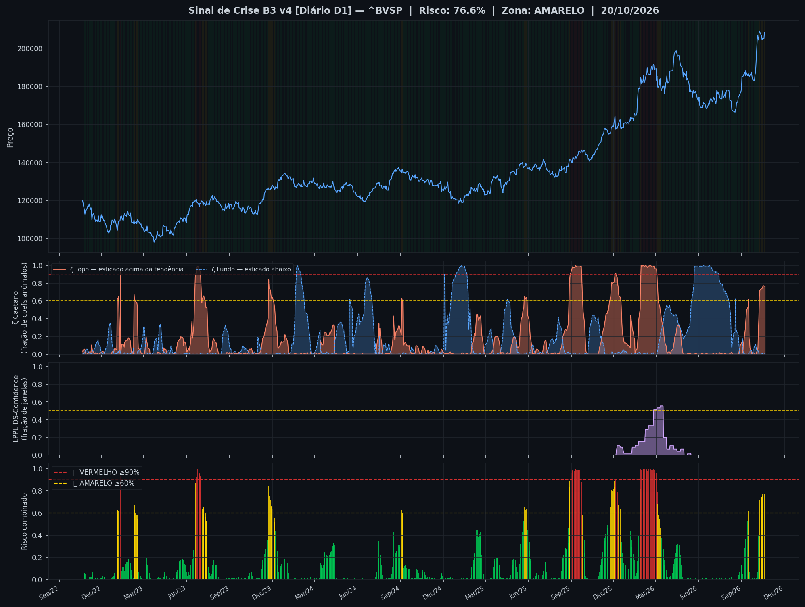
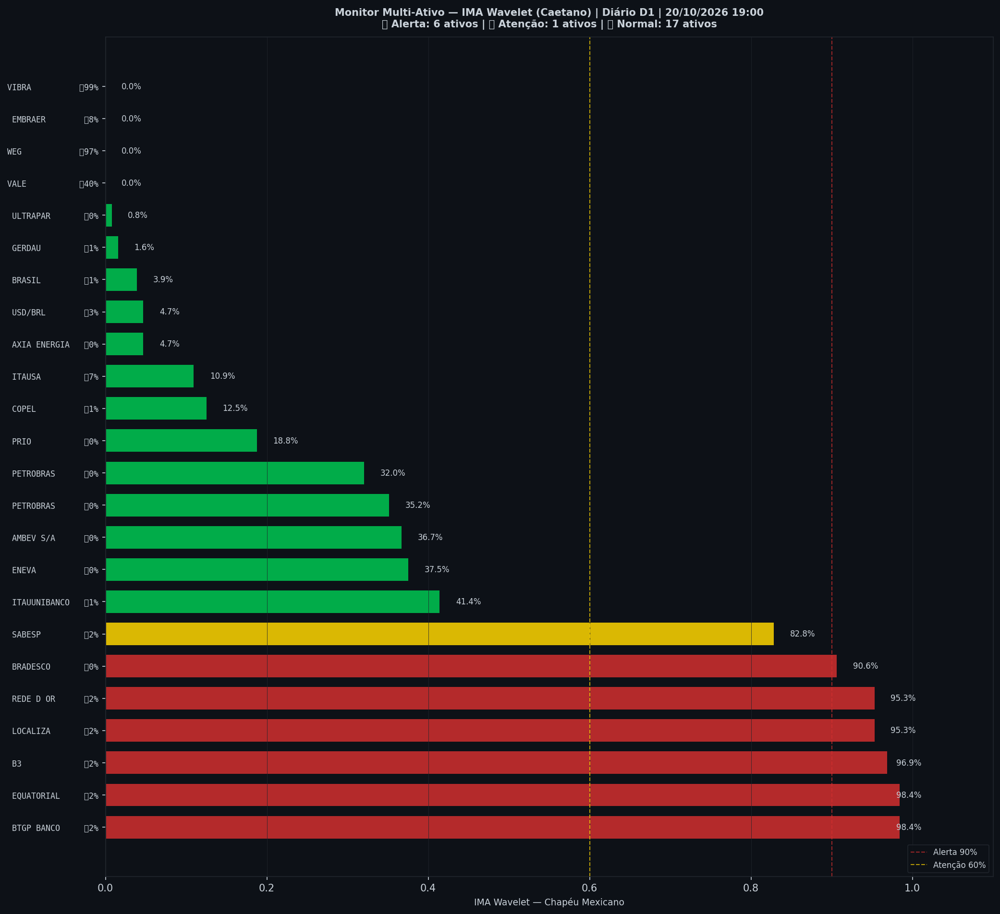

> [!warning] 🟡 **AMARELO** — Risco 77% · ＝ +0 p.p. vs leitura anterior
> `███████████████░░░░░`
> Atenção — preço esticado acima da tendência.

| Indicador | Valor |
|---|---|
| 🔴 ζ Topo — preço esticado acima da tendência | **77%** |
| 🔵 ζ Fundo — preço esticado abaixo da tendência | 1% |
| 🫧 LPPL bolha — alta super-exponencial (risco de crash) | 0% |
| 🫧 LPPL antibolha — queda super-exponencial (risco de repique) | 0% |
| 📊 Ibovespa | 208.296 pts |

## Últimos 30 pregões

| Data | Zona | Risco | ζ Topo | ζ Fundo | LPPL |
|---|---|---|---|---|---|
| 2026-10-20 | 🟡 AMARELO | **77%** | 77% | 1% | 0% |
| 2026-10-19 | 🟡 AMARELO | **77%** | 77% | 0% | 0% |
| 2026-10-16 | 🟡 AMARELO | **77%** | 77% | 0% | 0% |
| 2026-10-15 | 🟡 AMARELO | **75%** | 75% | 0% | 0% |
| 2026-10-14 | 🟡 AMARELO | **74%** | 74% | 1% | 0% |
| 2026-10-13 | 🟡 AMARELO | **74%** | 74% | 0% | 0% |
| 2026-10-09 | 🟡 AMARELO | **72%** | 72% | 0% | 0% |
| 2026-10-08 | 🟡 AMARELO | **63%** | 63% | 0% | 0% |
| 2026-10-07 | 🟢 VERDE | **40%** | 40% | 1% | 0% |
| 2026-10-06 | 🟢 VERDE | **25%** | 25% | 2% | 0% |
| 2026-10-05 | 🟢 VERDE | **6%** | 6% | 4% | 0% |
| 2026-10-02 | 🟢 VERDE | **2%** | 2% | 5% | 0% |
| 2026-10-01 | 🟢 VERDE | **0%** | 0% | 9% | 0% |
| 2026-09-30 | 🟢 VERDE | **0%** | 0% | 11% | 0% |
| 2026-09-29 | 🟢 VERDE | **0%** | 0% | 11% | 0% |
| 2026-09-28 | 🟢 VERDE | **1%** | 1% | 9% | 0% |
| 2026-09-25 | 🟢 VERDE | **2%** | 2% | 5% | 0% |
| 2026-09-24 | 🟢 VERDE | **1%** | 1% | 2% | 0% |
| 2026-09-23 | 🟢 VERDE | **0%** | 0% | 1% | 0% |
| 2026-09-22 | 🟢 VERDE | **0%** | 0% | 3% | 0% |
| 2026-09-21 | 🟢 VERDE | **2%** | 2% | 4% | 0% |
| 2026-09-18 | 🟢 VERDE | **7%** | 7% | 3% | 0% |
| 2026-09-17 | 🟢 VERDE | **15%** | 15% | 2% | 0% |
| 2026-09-16 | 🟢 VERDE | **18%** | 18% | 2% | 0% |
| 2026-09-15 | 🟡 AMARELO | **62%** | 62% | 0% | 0% |
| 2026-09-14 | 🟢 VERDE | **53%** | 53% | 0% | 0% |
| 2026-09-11 | 🟢 VERDE | **50%** | 50% | 0% | 0% |
| 2026-09-10 | 🟢 VERDE | **45%** | 45% | 0% | 0% |
| 2026-09-09 | 🟢 VERDE | **37%** | 37% | 0% | 0% |
| 2026-09-08 | 🟢 VERDE | **28%** | 28% | 0% | 0% |

## Monitor Multi-Ativo

**29% dos ativos em tensão** (6🔴 1🟡) — quanto mais ativos disparam juntos, mais confiável o sinal.

| Zona | Ativo | Setor | ζ Topo | ζ Fundo |
|---|---|---|---|---|
| 🔴 | **BTGP BANCO** | Financeiro | 98.4% | 1.6% |
| 🔴 | **EQUATORIAL** | Energia | 98.4% | 1.6% |
| 🔴 | **B3** | Financeiro | 96.9% | 1.6% |
| 🔴 | **LOCALIZA** | Aluguel | 95.3% | 1.6% |
| 🔴 | **REDE D OR** | Saúde | 95.3% | 1.6% |
| 🔴 | **BRADESCO** | Financeiro | 90.6% | 0.0% |
| 🟡 | **SABESP** | Saneamento | 82.8% | 1.6% |
| 🟢 | **ITAUUNIBANCO** | Financeiro | 41.4% | 0.8% |
| 🟢 | **ENEVA** | Energia | 37.5% | 0.0% |
| 🟢 | **AMBEV S/A** | Consumo | 36.7% | 0.0% |
| 🟢 | **PETROBRAS** | Petróleo | 35.2% | 0.0% |
| 🟢 | **PETROBRAS** | Petróleo | 32.0% | 0.0% |
| 🟢 | **PRIO** | Petróleo | 18.8% | 0.0% |
| 🟢 | **COPEL** | Energia | 12.5% | 0.8% |
| 🟢 | **ITAUSA** | Financeiro | 10.9% | 7.0% |
| 🟢 | **AXIA ENERGIA** | Energia | 4.7% | 0.0% |
| 🟢 | **USD/BRL** | Câmbio | 4.7% | 3.1% |
| 🟢 | **BRASIL** | Financeiro | 3.9% | 0.8% |
| 🟢 | **GERDAU** | Siderurgia | 1.6% | 0.8% |
| 🟢 | **ULTRAPAR** | Outros | 0.8% | 0.0% |
| 🟢 | **VALE** | Mineração | 0.0% | 39.8% |
| 🟢 | **WEG** | Industrial | 0.0% | 96.9% |
| 🟢 | **EMBRAER** | Outros | 0.0% | 7.8% |
| 🟢 | **VIBRA** | Energia | 0.0% | 99.2% |

*Página atualizada em 20/10/2026 19:24 BRT (leitura da barra de 2026-10-20 BRT).*

> [!info]- Como interpretar (clique para expandir)
> - **ζ Topo**: fração dos coeficientes wavelet (Chapéu Mexicano, Caetano & Yoneyama 2009) acima de +0,8σ na faixa mais recente. Na ponta da série isso acontece quando o preço termina **esticado acima da tendência** em muitas escalas — euforia/topo. ζ=0,90 é o limiar de Caetano: quedas que partiram desse padrão foram mais fundas. **É risco de reversão, não data do crash.**
> - **ζ Fundo**: o espelho — preço esticado abaixo da tendência, possível região de compra.
> - **LPPL DS-Confidence**: fração de 45 janelas (60–500 pregões) em que o modelo de Sornette produz um ajuste válido. **Bolha** (B<0): alta super-exponencial, risco de crash. **Antibolha** (B>0): queda super-exponencial, risco de repique. Evidência complementar; **não entra na zona**.
> - **Zonas com histerese**: o sinal só muda de zona ao cruzar o limiar de entrada, e só volta ao cruzar o de saída — evita flip-flop diário.

---
*Sinal de Crise B3 v4 · IMA Wavelet ([Caetano & Yoneyama, Physica-A 2007](https://doi.org/10.1016/j.physa.2007.03.054)) + LPPL DS-Confidence (Sornette, ETH-Zurich) · [Metodologia](metodologia) · [Histórico](historico)*

> [!quote]- Aviso
> Estudo acadêmico. Não constitui recomendação de investimento.
