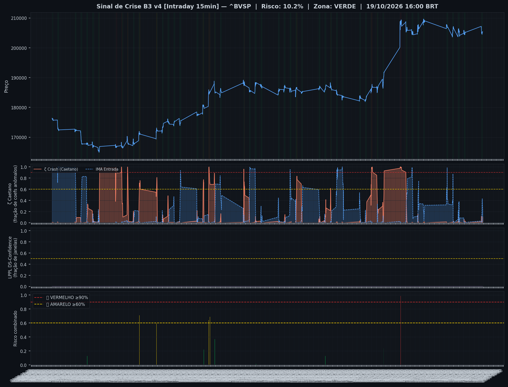
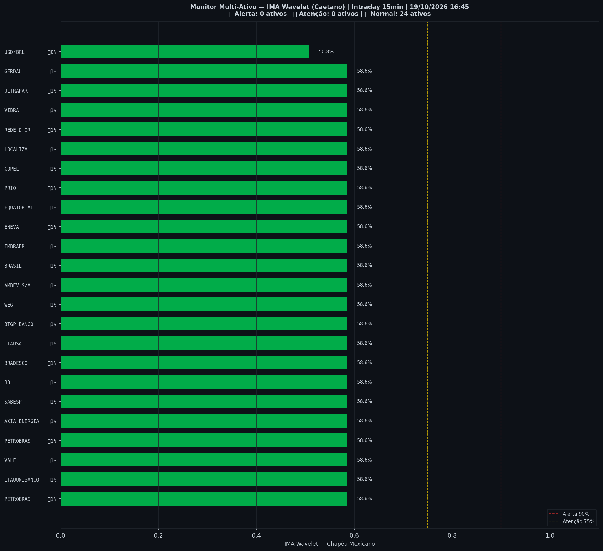

> [!success] 🟢 **VERDE** — Risco 10% · ▲ +10 p.p. vs leitura anterior
> `██░░░░░░░░░░░░░░░░░░`
> Mercado sem sinais relevantes de estresse.

| Indicador | Valor |
|---|---|
| 🔴 ζ Crash — severidade da queda em curso | **10%** |
| 🔵 ζ Entrada — estrutura de fundo | 0% |
| 🫧 LPPL DS-Confidence | 0% |
| 📊 Ibovespa | 205.319 pts |

## Últimos 30 pregões

| Data | Zona | Risco | IMA Crash | Entrada | LPPL |
|---|---|---|---|---|---|
| 2026-10-19 16:00 | 🟢 VERDE | **10%** | 10% | 0% | 0% |
| 2026-10-19 15:45 | 🟢 VERDE | **0%** | 0% | 24% | 0% |
| 2026-10-19 15:30 | 🟢 VERDE | **0%** | 0% | 27% | 0% |
| 2026-10-19 15:15 | 🟢 VERDE | **0%** | 0% | 30% | 0% |
| 2026-10-19 15:00 | 🟢 VERDE | **0%** | 0% | 30% | 0% |
| 2026-10-19 14:45 | 🟢 VERDE | **0%** | 0% | 35% | 0% |
| 2026-10-19 14:30 | 🟢 VERDE | **0%** | 0% | 40% | 0% |
| 2026-10-19 14:15 | 🟢 VERDE | **0%** | 0% | 43% | 0% |
| 2026-10-19 14:00 | 🟢 VERDE | **0%** | 0% | 42% | 0% |
| 2026-10-19 13:45 | 🟢 VERDE | **0%** | 0% | 41% | 0% |
| 2026-10-19 13:30 | 🟢 VERDE | **0%** | 0% | 34% | 0% |
| 2026-10-19 13:15 | 🟢 VERDE | **1%** | 1% | 28% | 0% |
| 2026-10-19 13:00 | 🟢 VERDE | **1%** | 1% | 22% | 0% |
| 2026-10-19 12:45 | 🟢 VERDE | **0%** | 0% | 17% | 0% |
| 2026-10-19 12:30 | 🟢 VERDE | **0%** | 0% | 16% | 0% |
| 2026-10-19 12:15 | 🟢 VERDE | **0%** | 0% | 11% | 0% |
| 2026-10-19 12:00 | 🟢 VERDE | **0%** | 0% | 9% | 0% |
| 2026-10-19 11:45 | 🟢 VERDE | **0%** | 0% | 6% | 0% |
| 2026-10-19 11:30 | 🟢 VERDE | **3%** | 3% | 3% | 0% |
| 2026-10-19 11:15 | 🟢 VERDE | **7%** | 7% | 2% | 0% |
| 2026-10-19 11:00 | 🟢 VERDE | **11%** | 11% | 1% | 0% |
| 2026-10-19 10:45 | 🟢 VERDE | **12%** | 12% | 0% | 0% |
| 2026-10-19 10:30 | 🟢 VERDE | **8%** | 8% | 2% | 0% |
| 2026-10-19 10:15 | 🟢 VERDE | **4%** | 4% | 2% | 0% |
| 2026-10-19 10:00 | 🟢 VERDE | **2%** | 2% | 3% | 0% |
| 2026-10-16 16:45 | 🟢 VERDE | **0%** | 0% | 1% | 0% |
| 2026-10-16 16:30 | 🟢 VERDE | **0%** | 0% | 1% | 0% |
| 2026-10-16 16:15 | 🟢 VERDE | **1%** | 1% | 1% | 0% |
| 2026-10-16 16:00 | 🟢 VERDE | **2%** | 2% | 0% | 0% |
| 2026-10-16 15:45 | 🟢 VERDE | **3%** | 3% | 0% | 0% |

## Monitor Multi-Ativo

**0% dos ativos em tensão** (0🔴 0🟡) — quanto mais ativos disparam juntos, mais confiável o sinal.

| Zona | Ativo | Setor | IMA Crash | IMA Entrada |
|---|---|---|---|---|
| 🟢 | **PETROBRAS** | Petróleo | 58.6% | 0.8% |
| 🟢 | **ITAUUNIBANCO** | Financeiro | 58.6% | 0.8% |
| 🟢 | **VALE** | Mineração | 58.6% | 0.8% |
| 🟢 | **PETROBRAS** | Petróleo | 58.6% | 0.8% |
| 🟢 | **AXIA ENERGIA** | Energia | 58.6% | 0.8% |
| 🟢 | **SABESP** | Saneamento | 58.6% | 0.8% |
| 🟢 | **B3** | Financeiro | 58.6% | 0.8% |
| 🟢 | **BRADESCO** | Financeiro | 58.6% | 0.8% |
| 🟢 | **ITAUSA** | Financeiro | 58.6% | 0.8% |
| 🟢 | **BTGP BANCO** | Financeiro | 58.6% | 0.8% |
| 🟢 | **WEG** | Industrial | 58.6% | 0.8% |
| 🟢 | **AMBEV S/A** | Consumo | 58.6% | 0.8% |
| 🟢 | **BRASIL** | Financeiro | 58.6% | 0.8% |
| 🟢 | **EMBRAER** | Outros | 58.6% | 0.8% |
| 🟢 | **ENEVA** | Energia | 58.6% | 0.8% |
| 🟢 | **EQUATORIAL** | Energia | 58.6% | 0.8% |
| 🟢 | **PRIO** | Petróleo | 58.6% | 0.8% |
| 🟢 | **COPEL** | Energia | 58.6% | 0.8% |
| 🟢 | **LOCALIZA** | Aluguel | 58.6% | 0.8% |
| 🟢 | **REDE D OR** | Saúde | 58.6% | 0.8% |
| 🟢 | **VIBRA** | Energia | 58.6% | 0.8% |
| 🟢 | **ULTRAPAR** | Outros | 58.6% | 0.8% |
| 🟢 | **GERDAU** | Siderurgia | 58.6% | 0.8% |
| 🟢 | **USD/BRL** | Câmbio | 50.8% | 0.0% |

*Página atualizada em 19/10/2026 16:45 BRT (leitura da barra de 2026-10-19 16:00 BRT).*

> [!info]- Como interpretar (clique para expandir)
> - **ζ Crash**: fração dos coeficientes wavelet acima do corte (Caetano & Yoneyama 2009). Escala absoluta: ζ=0,90 = 90% dos coeficientes anômalos — historicamente, quedas com ζ≥0,90 foram mais fundas e mais longas. **Mede a severidade do movimento em curso, não prevê o início da queda.**
> - **ζ Entrada**: coeficientes negativos além do corte — estrutura de fundo, possível região de compra.
> - **LPPL DS-Confidence**: fração de janelas (60–504 pregões) em que o modelo de bolha de Sornette produz um ajuste válido. 30% já é relevante; acima de 50% é forte evidência de estrutura de bolha.
> - **Zonas com histerese**: o sinal só muda de zona ao cruzar o limiar de entrada, e só volta ao cruzar o de saída — evita flip-flop diário.

---
*Sinal de Crise B3 v4 · IMA Wavelet ([Caetano & Yoneyama, Physica-A 2007](https://doi.org/10.1016/j.physa.2007.03.054)) + LPPL DS-Confidence (Sornette, ETH-Zurich) · [Metodologia](metodologia) · [Histórico](historico)*

> [!quote]- Aviso
> Estudo acadêmico. Não constitui recomendação de investimento.
