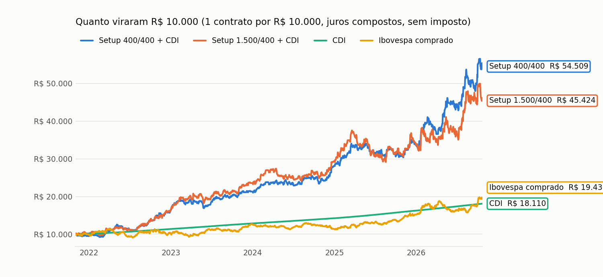
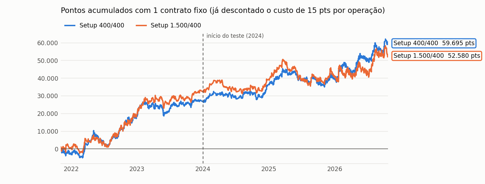
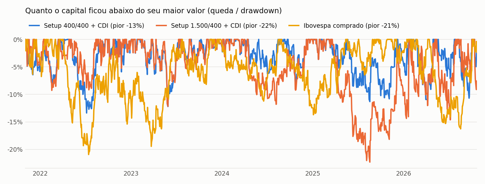
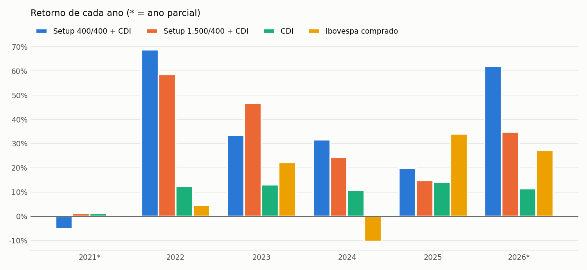

**Um setup simples de seguir a tendência do dia no mini índice, testado em 5 anos de dados e comparado com o CDI e com ficar comprado no Ibovespa.**

*Dados de 01/11/2021 a 23/10/2026 · página gerada em 25/10/2026 16:49 BRT · setup apresentado no vídeo do canal [Arthur 777 – Estratégias na Bolsa](https://youtu.be/N4CJ9Yv8To8), testado de forma independente nos nossos dados.*

> [!success] Em resumo: R$ 10.000 aplicados em nov/2021 viraram
> - **R$ 54.509** no Setup 400/400 com o capital no CDI (+41% ao ano)
> - **R$ 45.424** no Setup 1.500/400 com o capital no CDI (+36% ao ano)
> - **R$ 18.110** só no CDI (+13% ao ano)
> - **R$ 19.430** comprado no Ibovespa (+14% ao ano)
>
> Com 1 contrato de WIN para cada R$ 10.000, sem imposto. A pior queda foi de -13% (400/400), -22% (1.500/400) e -21% (Ibovespa).

> [!warning] Leia antes
> Resultado passado, em backtest, não garante resultado futuro. É um estudo educacional, **não é recomendação de investimento**. Day trade com mini índice é alavancado: dá para perder mais do que o capital da conta.

## Como o setup funciona

Gráfico de **15 minutos do mini índice (WIN)**. Três condições na mesma vela, e a entrada é na vela seguinte.

| | 🟢 Compra | 🔴 Venda |
|---|---|---|
| **1. Tendência** | a vela **fecha acima** das três médias exponenciais de 9, 50 e 200 períodos | a vela **fecha abaixo** das três médias |
| **2. Força do dia** | o fechamento está **pelo menos 700 pontos acima** da abertura do dia | o fechamento está **pelo menos 700 pontos abaixo** da abertura do dia |
| **3. Gatilho** | a vela **fecha acima da máxima** da vela anterior | a vela **fecha abaixo da mínima** da vela anterior |
| **Entrada** | compra **a mercado** na abertura da vela seguinte | vende a mercado na abertura da vela seguinte |
| **Stop** | 400 pontos abaixo da entrada | 400 pontos acima da entrada |
| **Alvo** | 400 pontos (versão 400/400) ou 1.500 pontos (versão 1.500/400) | o mesmo, para baixo |
| **Saída no fim do dia** | se não bateu nem o stop nem o alvo, zera às 18h20 | igual |

- **Horário dos sinais:** da primeira vela do dia até 17h00.
- **Quantas operações por dia:** sem limite, mas **uma de cada vez**. Enquanto o dia continuar forte, o setup entra de novo depois que a operação anterior termina.
- **A ordem das médias entre si não importa**, só o preço estar do mesmo lado das três.
- **A ideia:** em dia de tendência forte (o preço já andou 700 pontos e está do lado certo das médias), cada nova vela de força tende a ter continuação.

### As duas versões

| | Setup 400/400 | Setup 1.500/400 |
|---|---|---|
| Alvo ÷ stop (risco/retorno) | 1 para 1 | 3,75 para 1 |
| Acerto mínimo para empatar (com custo) | cerca de 52% | cerca de 22% (mais as saídas no fim do dia) |
| Acerto real | **55%** | **36%** |
| Jeito de operar | sai rápido (tempo mediano 40 min), muitas operações | o alvo quase nunca é atingido (10%); na prática fica no stop ou leva o dia até o fim |
| Qual foi melhor no teste | ✅ mais estável, menos queda | maior ganho por operação no treino, mais oscilação |

## Estatísticas da operação (1 contrato, em pontos)

Cada operação já desconta **15 pontos de custo** (corretagem, emolumentos e escorregão na entrada a mercado). R$ = pontos × R$ 0,20 por contrato. **Treino** = nov/2021 a dez/2023 · **Teste** = 2024 até hoje.

### Setup 400/400

| | Treino | Teste | Total |
|---|---|---|---|
| Operações | 1.131 | 1.586 | 2.717 |
| Operações por mês | 41,9 | 46,6 | 44,5 |
| Taxa de acerto | 54,8% | 54,5% | 54,6% |
| Bateram o alvo / o stop / zeraram no fim do dia | 48% / 39% / 13% | 49% / 40% / 11% | 49% / 40% / 12% |
| Ganho médio | 357 pts | 360 pts | 359 pts |
| Perda média | -380 pts | -386 pts | -383 pts |
| Payoff (ganho médio ÷ perda média) | 0,94 | 0,93 | 0,94 |
| Fator de lucro (total ganho ÷ total perdido) | 1,14 | 1,12 | 1,13 |
| Resultado médio por operação | 24,0 pts | 20,5 pts | 22,0 pts |
| **Lucro líquido** | **27.155 pts · R$ 5.431** | **32.540 pts · R$ 6.508** | **59.695 pts · R$ 11.939** |
| Pior queda (drawdown) | -8.935 pts · −R$ 1.787 | -10.310 pts · −R$ 2.062 | -10.310 pts · −R$ 2.062 |
| Maior sequência de perdas | 8 seguidas | 10 seguidas | 10 seguidas |
| Compras: acerto · lucro | 56% · 14.665 pts | 55% · 19.400 pts | 55% · 34.065 pts |
| Vendas: acerto · lucro | 54% · 12.490 pts | 54% · 13.140 pts | 54% · 25.630 pts |

### Setup 1.500/400

| | Treino | Teste | Total |
|---|---|---|---|
| Operações | 622 | 946 | 1.568 |
| Operações por mês | 23,0 | 27,8 | 25,7 |
| Taxa de acerto | 39,5% | 33,7% | 36,0% |
| Bateram o alvo / o stop / zeraram no fim do dia | 8% / 53% / 39% | 11% / 59% / 29% | 10% / 57% / 33% |
| Ganho médio | 716 pts | 823 pts | 776 pts |
| Perda média | -381 pts | -387 pts | -385 pts |
| Payoff (ganho médio ÷ perda média) | 1,88 | 2,13 | 2,02 |
| Fator de lucro (total ganho ÷ total perdido) | 1,23 | 1,08 | 1,14 |
| Resultado médio por operação | 52,7 pts | 20,9 pts | 33,5 pts |
| **Lucro líquido** | **32.775 pts · R$ 6.555** | **19.805 pts · R$ 3.961** | **52.580 pts · R$ 10.516** |
| Pior queda (drawdown) | -7.230 pts · −R$ 1.446 | -15.055 pts · −R$ 3.011 | -15.055 pts · −R$ 3.011 |
| Maior sequência de perdas | 14 seguidas | 15 seguidas | 15 seguidas |
| Compras: acerto · lucro | 41% · 16.930 pts | 34% · 16.765 pts | 37% · 33.695 pts |
| Vendas: acerto · lucro | 38% · 15.845 pts | 34% · 3.040 pts | 35% · 18.885 pts |

> [!info]- O que significa cada número (clique para abrir)
> - **Taxa de acerto:** de cada 100 operações, quantas deram lucro.
> - **Payoff:** quanto se ganha em média numa operação boa, comparado com quanto se perde numa ruim. Payoff 2 = o ganho médio é o dobro da perda média.
> - **Fator de lucro:** tudo o que foi ganho dividido por tudo o que foi perdido. Acima de 1 = deu lucro; 1,15 = para cada R$ 1,00 perdido, ganhou R$ 1,15.
> - **Risco/retorno:** o tamanho do alvo comparado com o do stop. Alvo de 1.500 e stop de 400 = 3,75 para 1.
> - **Acerto mínimo para empatar:** com alvo e stop do mesmo tamanho, é preciso acertar um pouco mais da metade por causa do custo. Com alvo grande, dá para acertar bem menos.
> - **Drawdown (pior queda):** a maior distância entre o ponto mais alto do lucro acumulado e o fundo que veio depois. É o pior momento que alguém teria passado seguindo o setup.
> - **Treino e teste:** os números de 2024 em diante funcionam como uma prova: se o setup só funcionasse no passado, o teste ia mostrar.

## Comparação com o CDI e com o Ibovespa comprado

Para comparar pontos com porcentagem, a conta usa **R$ 10.000 de capital para cada contrato** de WIN (o número de contratos cresce junto com o capital, juros compostos). Duas versões do setup:

- **+ CDI:** o capital fica aplicado no CDI / Tesouro Selic (as corretoras aceitam como garantia) e o resultado do setup soma por cima. **É a comparação justa.**
- **Pura:** o capital fica parado; só o resultado das operações.

O Ibovespa já inclui os dividendos reinvestidos. Nenhum dos números desconta imposto.

### Resultado total

| | Setup 400/400 + CDI | Setup 1.500/400 + CDI | Setup 400/400 pura | Setup 1.500/400 pura | CDI | Ibovespa comprado |
|---|---|---|---|---|---|---|
| **R$ 10.000 viraram** | **R$ 54.509** | **R$ 45.424** | **R$ 30.114** | **R$ 25.092** | **R$ 18.110** | **R$ 19.430** |
| Retorno acumulado | +445% | +354% | +201% | +151% | +81% | +94% |
| Retorno ao ano | +41,0% | +35,9% | +25,0% | +20,5% | +12,8% | +14,4% |
| Pior queda | -13,4% | -22,3% | -18,3% | -26,5% | +0,0% | -20,9% |
| Oscilação ao ano (volatilidade) | 19,3% | 23,2% | 19,3% | 23,2% | 0,1% | 17,5% |
| Sharpe (retorno acima do CDI ÷ oscilação) | 1,25 | 0,92 | 0,63 | 0,40 | — | 0,17 |
| Meses positivos | 67% | 65% | 58% | 62% | 100% | 60% |
| Meses acima do CDI | 58% | 62% | 50% | 53% | — | 57% |
| Meses acima do Ibovespa | 55% | 60% | 48% | 52% | 43% | — |
| Pior mês | -6,3% | -8,6% | -7,4% | -9,5% | +0,6% | -11,5% |
| Melhor mês | +16,5% | +15,2% | +15,2% | +13,9% | +1,3% | +12,6% |

### Ano a ano

| Ano | Setup 400/400 + CDI | Setup 1.500/400 + CDI | CDI | Ibovespa comprado | Quem ganhou |
|---|---|---|---|---|---|
| 2021* | -5,2% | +1,3% | +1,3% | -0,7% | Setup 1.500/400 + CDI |
| 2022 | +68,7% | +58,7% | +12,3% | +4,7% | Setup 400/400 + CDI |
| 2023 | +33,5% | +46,9% | +13,0% | +22,3% | Setup 1.500/400 + CDI |
| 2024 | +31,5% | +24,4% | +10,8% | -10,4% | Setup 400/400 + CDI |
| 2025 | +19,8% | +14,7% | +14,2% | +34,0% | Ibovespa comprado |
| 2026* | +61,9% | +34,8% | +11,4% | +27,3% | Setup 400/400 + CDI |

\* ano parcial: os dados começam em 01/11/2021 e vão até 23/10/2026.

> [!example]- Mês a mês (clique para abrir)
> | Mês | Setup 400/400 + CDI | Setup 1.500/400 + CDI | CDI | Ibovespa | 400/400 + CDI bateu |
> |---|---|---|---|---|---|
> | nov/2021 | -5,5% | -1,8% | +0,6% | -3,4% | — |
> | dez/2021 | +0,4% | +3,2% | +0,7% | +2,9% | — |
> | jan/2022 | +2,8% | +2,7% | +0,7% | +7,0% | CDI |
> | fev/2022 | -4,1% | -5,3% | +0,8% | +0,9% | — |
> | mar/2022 | +15,0% | +13,1% | +0,9% | +6,1% | CDI e Ibovespa |
> | abr/2022 | +12,8% | +6,7% | +0,8% | -10,1% | CDI e Ibovespa |
> | mai/2022 | -3,1% | -3,6% | +1,0% | +3,2% | — |
> | jun/2022 | -4,6% | -2,4% | +1,0% | -11,5% | Ibovespa |
> | jul/2022 | -0,3% | -1,0% | +1,0% | +4,7% | — |
> | ago/2022 | +12,3% | +15,2% | +1,2% | +6,2% | CDI e Ibovespa |
> | set/2022 | +8,8% | +6,6% | +1,1% | +0,5% | CDI e Ibovespa |
> | out/2022 | +10,1% | +7,0% | +1,0% | +5,5% | CDI e Ibovespa |
> | nov/2022 | +0,0% | +4,4% | +1,0% | -3,1% | Ibovespa |
> | dez/2022 | +6,5% | +5,8% | +1,1% | -2,4% | CDI e Ibovespa |
> | jan/2023 | +16,5% | +14,1% | +1,1% | +3,4% | CDI e Ibovespa |
> | fev/2023 | +0,1% | +5,7% | +0,9% | -7,5% | Ibovespa |
> | mar/2023 | +1,7% | +2,9% | +1,2% | -2,9% | CDI e Ibovespa |
> | abr/2023 | -3,9% | -1,8% | +0,9% | +2,5% | — |
> | mai/2023 | -5,8% | -4,7% | +1,1% | +3,7% | — |
> | jun/2023 | +8,0% | +6,9% | +1,1% | +9,0% | CDI |
> | jul/2023 | +6,3% | +6,4% | +1,1% | +3,3% | CDI e Ibovespa |
> | ago/2023 | +4,1% | +1,8% | +1,1% | -5,1% | CDI e Ibovespa |
> | set/2023 | -2,5% | -2,4% | +1,0% | +0,7% | — |
> | out/2023 | +2,0% | +1,0% | +1,0% | -2,9% | CDI e Ibovespa |
> | nov/2023 | +3,8% | +8,0% | +0,9% | +12,5% | CDI |
> | dez/2023 | +1,0% | +2,6% | +0,9% | +5,4% | CDI |
> | jan/2024 | +5,5% | +3,1% | +1,0% | -4,8% | CDI e Ibovespa |
> | fev/2024 | +5,6% | +10,9% | +0,8% | +1,0% | CDI e Ibovespa |
> | mar/2024 | -0,9% | +0,2% | +0,8% | -0,7% | — |
> | abr/2024 | +0,2% | -5,4% | +0,9% | -1,7% | Ibovespa |
> | mai/2024 | +1,2% | -1,4% | +0,8% | -3,0% | CDI e Ibovespa |
> | jun/2024 | -0,9% | +1,2% | +0,8% | +1,5% | — |
> | jul/2024 | -1,8% | -2,8% | +0,9% | +3,0% | — |
> | ago/2024 | +7,3% | +2,5% | +0,9% | +6,5% | CDI e Ibovespa |
> | set/2024 | -0,7% | +3,3% | +0,8% | -3,1% | Ibovespa |
> | out/2024 | -3,6% | -3,0% | +0,9% | -1,6% | — |
> | nov/2024 | +5,2% | +6,3% | +0,8% | -3,1% | CDI e Ibovespa |
> | dez/2024 | +11,7% | +8,5% | +0,8% | -4,3% | CDI e Ibovespa |
> | jan/2025 | +7,8% | +12,0% | +1,0% | +4,9% | CDI e Ibovespa |
> | fev/2025 | +4,1% | +6,2% | +1,0% | -2,6% | CDI e Ibovespa |
> | mar/2025 | +5,4% | +3,7% | +1,0% | +6,1% | CDI |
> | abr/2025 | -2,2% | -8,2% | +1,1% | +3,7% | — |
> | mai/2025 | +1,9% | +2,2% | +1,1% | +1,5% | CDI e Ibovespa |
> | jun/2025 | -4,5% | -8,6% | +1,1% | +1,3% | — |
> | jul/2025 | -1,8% | -2,3% | +1,3% | -4,2% | Ibovespa |
> | ago/2025 | +5,1% | +9,4% | +1,2% | +6,3% | CDI |
> | set/2025 | -5,2% | -5,3% | +1,2% | +3,4% | — |
> | out/2025 | -0,8% | -1,3% | +1,3% | +2,3% | — |
> | nov/2025 | +7,4% | +6,7% | +1,1% | +6,4% | CDI e Ibovespa |
> | dez/2025 | +2,0% | +1,7% | +1,1% | +1,3% | CDI e Ibovespa |
> | jan/2026 | +12,0% | +10,1% | +1,2% | +12,6% | CDI |
> | fev/2026 | +3,5% | -6,8% | +1,0% | +4,1% | CDI |
> | mar/2026 | -6,3% | +2,1% | +1,2% | -0,7% | — |
> | abr/2026 | +14,3% | +7,6% | +1,1% | -0,1% | CDI e Ibovespa |
> | mai/2026 | +7,1% | -1,7% | +1,1% | -7,2% | CDI e Ibovespa |
> | jun/2026 | -2,0% | -0,1% | +1,1% | -1,0% | — |
> | jul/2026 | +10,9% | +13,2% | +1,2% | +3,5% | CDI e Ibovespa |
> | ago/2026 | +0,9% | +5,6% | +1,1% | -0,3% | Ibovespa |
> | set/2026 | +6,7% | +2,9% | +1,1% | +5,0% | CDI e Ibovespa |
> | out/2026 | +4,0% | -1,2% | +0,8% | +10,1% | CDI |

### E se o capital por contrato for outro?

Quanto menos capital por contrato, mais alavancado: o retorno sobe, mas a queda também. Versão + CDI, total do período:

| Capital por contrato | Setup 400/400 + CDI | Setup 1.500/400 + CDI |
|---|---|---|
| R$ 5.000 | +70% ao ano · pior queda -28% | +55% ao ano · pior queda -44% |
| R$ 10.000 | +41% ao ano · pior queda -13% | +36% ao ano · pior queda -22% |
| R$ 20.000 | +27% ao ano · pior queda -6% | +25% ao ano · pior queda -9% |
| R$ 40.000 | +20% ao ano · pior queda -2% | +19% ao ano · pior queda -3% |
| *referência* | *CDI: +13% ao ano* | *Ibovespa: +14% ao ano, pior queda -21%* |

## Por que dá para confiar mais neste setup

Antes desta página, testamos dezenas de setups e quase todos empataram com o acaso depois do custo. Este passou em todos os testes de robustez (rodados em 25/10/2026):

| Teste | O que mostrou |
|---|---|
| **Bate com o vídeo?** | Sim. No 1.500/400 o vídeo mostra 32% de acerto, payoff 2,52 e fator de lucro 1,19; nos nossos dados deu 36%, 2,10 e 1,21 (sem custo). |
| **Ganha do acaso?** | Sim. Entradas em horários quaisquer, com o mesmo alvo e stop, perdem de 9 a 19 pts por operação; o setup ganha cerca de 20 pts por operação no teste. |
| **É sorte de parâmetro?** | Não. Mudando a distância (500, 700, 900 pts) e o stop (300, 400, 500 pts), as 9 combinações deram lucro no treino **e** no teste, nas duas versões. |
| **Cada condição importa?** | Sim. Tirar as médias, a distância ou o gatilho piora o resultado; cada condição sozinha não funciona. |
| **Funciona com o mercado de outro tamanho?** | Sim. Com distância, stop e alvo proporcionais à oscilação média do dia (ATR) em vez de pontos fixos, o resultado foi igual ou melhor. |
| **Aguenta custo maior?** | Até uns 30 pts por operação. No teste, o lucro só zera com cerca de 36 pts de custo por operação. |
| **Funciona na compra e na venda?** | Sim, as duas dão lucro — por isso o setup ganhou até em 2024, quando o Ibovespa caiu. |

## Riscos e cuidados

- **A margem é fina:** cerca de 21 pts líquidos por operação no teste (400/400). Escorregão maior que o normal na entrada a mercado come esse resultado.
- **Fases ruins longas:** a pior queda do 1.500/400 (−R$ 3.011 por contrato, começou em mar/2025 e só foi recuperada em ago/2026); a do 400/400 (−R$ 2.062 por contrato, começou em mar/2025 e só foi recuperada em fev/2026). Em 2025 o setup rendeu perto do CDI e o Ibovespa ganhou dos dois.
- **Sequências de perdas:** 10 perdas seguidas no 400/400 e 15 no 1.500/400 aconteceram no período.
- **Mês a mês é quase cara ou coroa:** o setup fica abaixo do CDI em cerca de 4 a cada 10 meses. O resultado aparece no ano.
- **Pontos fixos:** 700 e 400 pontos eram uma fatia maior do índice em 2021 (~105 mil pts) do que hoje (~210 mil). A versão com ATR mostrou que a ideia continua valendo, mas os números exatos mudam.
- **Poucos anos de dados:** 5 anos, com 2022 pesando bastante no resultado. Sem imposto (day trade paga 20% sobre o lucro).

## Como o teste foi feito

- **Dados:** WIN$N (série contínua do mini índice) em velas de 1 minuto do MetaTrader 5, de 25/10/2021 a 23/10/2026, com os saltos das rolagens de contrato ajustados para as médias móveis; stop, alvo e resultado em **pontos reais** do contrato de cada época.
- **Execução realista:** cada operação foi acompanhada minuto a minuto. Se o stop e o alvo caíram no mesmo minuto, contou como **stop** (o pior caso). Se o preço abriu além do stop, a saída foi no preço da abertura.
- **Custo:** 15 pontos por operação. **CDI:** série diária do Banco Central. **Ibovespa:** fechamento diário, comprado e segurado o período todo.
- **Ninguém escolheu os parâmetros olhando estes dados:** as regras vieram prontas do vídeo, e o período de 2024 em diante serviu como prova.

*Leitura educacional baseada em backtest. Não é recomendação de investimento.*
