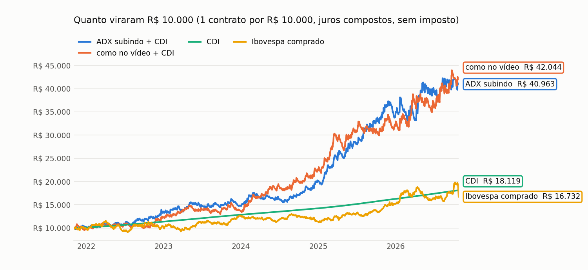
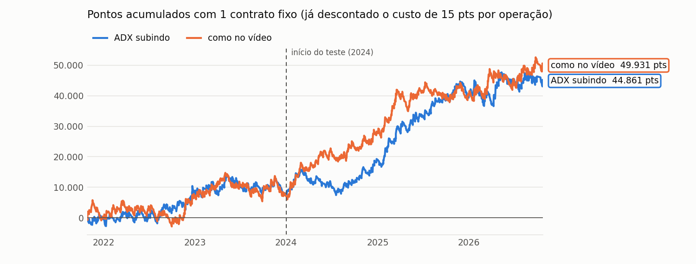
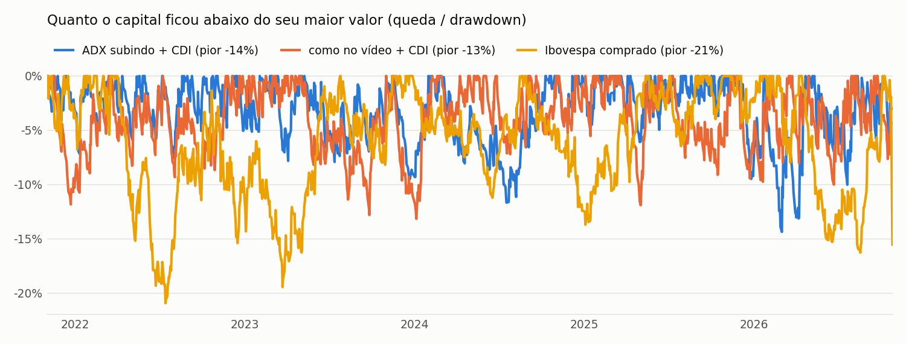
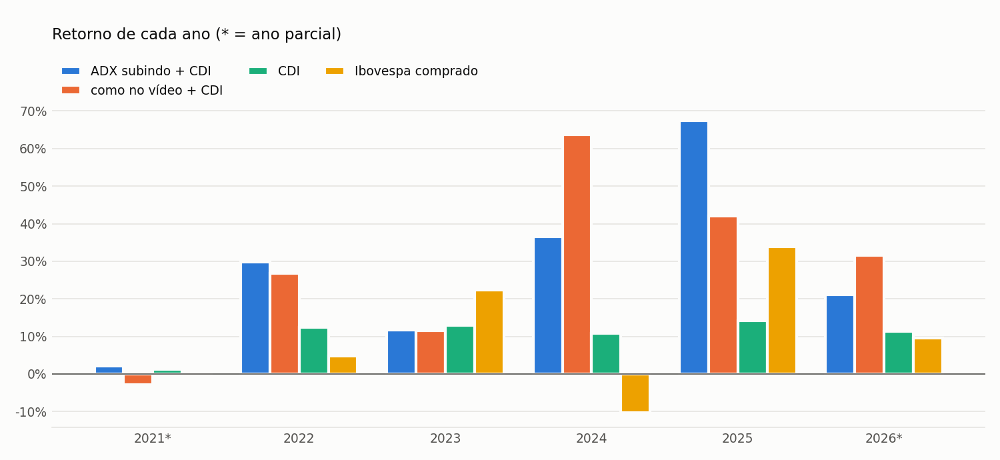

**Aposta curta e barata no começo da tendência das 10h às 11h: vela a favor com o ADX subindo, stop pequeno e alvo bem longo.**

🟡 promissor · Mini índice (WIN) · gráfico de 15 minutos · só as velas das 10h00, 10h15, 10h30, 10h45 e 11h00

🎬 **Vídeo de origem:** [Arthur 777 – "esse indicador é bizarro no mini índice"](https://youtu.be/D9mwdxexECE) · testado de forma independente nos nossos dados em 26/10/2026 · página gerada em 26/10/2026 20:19 BRT · [voltar para todos os setups](./)

> [!success] Em resumo: R$ 10.000 aplicados em nov/2021 viraram
> - **R$ 40.963** na versão ADX subindo com o capital no CDI (+33% ao ano · pior queda −14%)
> - **R$ 42.044** na versão como no vídeo com o capital no CDI (+34% ao ano · pior queda −13%)
> - **R$ 18.119** só no CDI (+13% ao ano)
> - **R$ 16.732** comprado no Ibovespa (+11% ao ano · pior queda −21%)
>
> Com 1 contrato de WIN para cada R$ 10.000, sem imposto.

> [!warning] Leia antes
> Resultado passado, em backtest, não garante resultado futuro. É um estudo educacional, **não é recomendação de investimento**. Day trade com mini índice é alavancado: dá para perder mais do que o capital da conta.

## Como o setup funciona

| | 🟢 Compra | 🔴 Venda |
|---|---|---|
| **1. Horário** | a vela começa entre 10h00 e 11h00 | igual |
| **2. Vela a favor** | a vela é **positiva** (fecha acima da abertura) | a vela é **negativa** (fecha abaixo da abertura) |
| **3. ADX(9, média 9)** | o ADX está **subindo** (maior que na vela anterior) | o ADX está **subindo** (versão principal — o ADX mede força, não direção) ou descendo (como no vídeo) |
| **4. Filtro** | a vela tem **no máximo 1.000 pontos** (evita dias de volatilidade anormal) | igual |
| **Entrada** | compra **a mercado** na abertura da vela seguinte | vende a mercado na abertura da vela seguinte |
| **Stop** | **0,15%** abaixo da entrada (≈ 270 pts) | 0,15% acima da entrada |
| **Alvo** | **1,30%** acima da entrada (≈ 2.300 pts) | 1,30% abaixo da entrada |
| **Fim do dia** | se não bateu stop nem alvo, zera às 18h20 | igual |

- **Uma operação de cada vez.** Se tomar stop cedo, pode entrar de novo numa vela seguinte ainda dentro da janela das 10h às 11h.
- **Acerta pouco e ganha muito quando acerta:** cerca de 1 em cada 5 operações dá lucro, mas o ganho médio é 5 a 6 vezes a perda média.
- **Sem condução do trade** (sem stop no zero a zero), exatamente como no vídeo.

### As versões testadas

| | ADX subindo (principal) | como no vídeo |
|---|---|---|
| Regra | venda com ADX subindo · alvo 1,30% · stop 0,15% | venda com ADX descendo · alvo 1,30% · stop 0,15% |
| Acerto | 18% | 18% |
| Payoff | 5,10 | 5,21 |
| Treino → teste (pts por operação) | +9,6 → +40,4 | +7,9 → +41,1 |
| Retorno ao ano (+ CDI) | +33,1% | +33,8% |
| Pior queda (+ CDI) | −14,4% | −13,2% |

## Estatísticas da operação (1 contrato, em pontos)

Cada operação já desconta **15 pontos de custo** (corretagem, emolumentos e escorregão). R$ = pontos × R$ 0,20 por contrato. **Treino** = nov/2021 a dez/2023 · **Teste** = 2024 até hoje.

### Versão ADX subindo

| | Treino | Teste | Total |
|---|---|---|---|
| Operações | 819 | 915 | 1.734 |
| Operações por mês | 30,3 | 26,9 | 28,4 |
| Taxa de acerto | 15,1% | 21,3% | 18,4% |
| Bateram o alvo / o stop / zeraram no fim do dia | 8% / 84% / 8% | 5% / 78% / 17% | 7% / 81% / 12% |
| Stop típico | 167 pts | 206 pts | 188 pts |
| Ganho médio · perda média | +1.086 · −182 pts | +1.066 · −237 pts | +1.074 · −210 pts |
| Payoff (ganho médio ÷ perda média) | 5,95 | 4,49 | 5,10 |
| Fator de lucro (total ganho ÷ total perdido) | 1,06 | 1,22 | 1,15 |
| Resultado médio por operação | +9,6 pts (+24,6 sem custo) | +40,4 pts (+55,4 sem custo) | +25,9 pts (+40,9 sem custo) |
| **Lucro líquido** | **+7.899 pts · R$ 1.580** | **+36.962 pts · R$ 7.392** | **+44.861 pts · R$ 8.972** |
| Pior queda (drawdown) | −6.191 pts · −R$ 1.238 | −8.455 pts · −R$ 1.691 | −8.455 pts · −R$ 1.691 |
| Maior sequência de perdas | 24 seguidas | 18 seguidas | 24 seguidas |
| Compras: acerto · lucro | 15% · +471 pts | 20% · +14.284 pts | 17% · +14.755 pts |
| Vendas: acerto · lucro | 16% · +7.427 pts | 23% · +22.678 pts | 19% · +30.106 pts |

### Versão como no vídeo

| | Treino | Teste | Total |
|---|---|---|---|
| Operações | 923 | 1.037 | 1.960 |
| Operações por mês | 34,2 | 30,5 | 32,1 |
| Taxa de acerto | 14,8% | 20,9% | 18,1% |
| Bateram o alvo / o stop / zeraram no fim do dia | 8% / 84% / 7% | 6% / 78% / 16% | 7% / 81% / 12% |
| Stop típico | 168 pts | 205 pts | 189 pts |
| Ganho médio · perda média | +1.100 · −182 pts | +1.085 · −235 pts | +1.091 · −209 pts |
| Payoff (ganho médio ÷ perda média) | 6,03 | 4,61 | 5,21 |
| Fator de lucro (total ganho ÷ total perdido) | 1,05 | 1,22 | 1,15 |
| Resultado médio por operação | +7,9 pts (+22,9 sem custo) | +41,1 pts (+56,1 sem custo) | +25,5 pts (+40,5 sem custo) |
| **Lucro líquido** | **+7.301 pts · R$ 1.460** | **+42.629 pts · R$ 8.526** | **+49.931 pts · R$ 9.986** |
| Pior queda (drawdown) | −9.325 pts · −R$ 1.865 | −7.054 pts · −R$ 1.411 | −9.325 pts · −R$ 1.865 |
| Maior sequência de perdas | 32 seguidas | 30 seguidas | 32 seguidas |
| Compras: acerto · lucro | 14% · −2.086 pts | 22% · +31.214 pts | 19% · +29.128 pts |
| Vendas: acerto · lucro | 15% · +9.388 pts | 20% · +11.415 pts | 18% · +20.803 pts |

> [!info]- O que significa cada número (clique para abrir)
> - **Taxa de acerto:** de cada 100 operações, quantas deram lucro.
> - **Payoff:** o ganho médio de uma operação boa dividido pela perda média de uma ruim. Payoff 2 = ganha o dobro do que perde.
> - **Fator de lucro:** tudo o que foi ganho dividido por tudo o que foi perdido. Acima de 1 = deu lucro.
> - **Risco/retorno:** o tamanho do alvo comparado com o do stop.
> - **Drawdown (pior queda):** a maior distância entre o ponto mais alto do lucro acumulado e o fundo que veio depois — o pior momento que alguém teria passado seguindo o setup.
> - **Sharpe:** quanto o investimento rendeu acima do CDI para cada unidade de oscilação. Acima de 1 é muito bom.
> - **Treino e teste:** os parâmetros vêm do vídeo; 2024 em diante funciona como prova — se o setup só funcionasse no passado, o teste ia mostrar.

## Comparação com o CDI e com o Ibovespa comprado

A conta usa **R$ 10.000 de capital para cada contrato** (o número de contratos cresce junto com o capital). Na versão **+ CDI** o capital fica aplicado no CDI / Tesouro Selic (aceito como garantia) e o resultado do setup soma por cima — é a comparação justa. Na **pura**, o capital fica parado. O Ibovespa já inclui dividendos. Sem imposto.

| | ADX subindo + CDI | como no vídeo + CDI | ADX subindo pura | CDI | Ibovespa |
|---|---|---|---|---|---|
| **R$ 10.000 viraram** | **R$ 40.963** | **R$ 42.044** | **R$ 22.616** | **R$ 18.119** | **R$ 16.732** |
| Retorno ao ano | +33,1% | +33,8% | +18,0% | +12,8% | +11,0% |
| Pior queda | −14,4% | −13,2% | −15,5% | +0,0% | −20,9% |
| Oscilação ao ano | 20,5% | 22,1% | 20,5% | 0,1% | 18,6% |
| Sharpe (acima do CDI) | 0,91 | 0,88 | 0,32 | — | 0,01 |
| Meses acima do CDI | 60% | 60% | 53% | — | 55% |
| Meses acima do Ibovespa | 60% | 57% | 50% | 45% | — |
| Pior mês · melhor mês | −10,0% · +18,9% | −7,4% · +15,6% | −10,9% · +17,7% | +0,6% · +1,3% | −11,5% · +12,6% |

### Ano a ano

| Ano | ADX subindo + CDI | como no vídeo + CDI | CDI | Ibovespa | Quem ganhou |
|---|---|---|---|---|---|
| 2021* | +2,1% | −2,8% | +1,3% | −0,7% | ADX subindo + CDI |
| 2022 | +29,8% | +26,8% | +12,3% | +4,7% | ADX subindo + CDI |
| 2023 | +11,7% | +11,5% | +13,0% | +22,3% | Ibovespa |
| 2024 | +36,5% | +63,7% | +10,8% | −10,4% | como no vídeo + CDI |
| 2025 | +67,5% | +42,1% | +14,2% | +34,0% | ADX subindo + CDI |
| 2026* | +21,0% | +31,6% | +11,4% | +9,6% | como no vídeo + CDI |

\* ano parcial: os dados vão de 01/11/2021 a 26/10/2026.

> [!example]- Mês a mês (clique para abrir)
> | Mês | ADX subindo + CDI | como no vídeo + CDI | CDI | Ibovespa |
> |---|---|---|---|---|
> | nov/2021 | +1,3% | +1,8% | +0,6% | −3,4% |
> | dez/2021 | +0,8% | −4,5% | +0,7% | +2,9% |
> | jan/2022 | +2,7% | +2,2% | +0,7% | +7,0% |
> | fev/2022 | −1,1% | +5,6% | +0,8% | +0,9% |
> | mar/2022 | +4,5% | +0,6% | +0,9% | +6,1% |
> | abr/2022 | −4,1% | −2,9% | +0,8% | −10,1% |
> | mai/2022 | +6,6% | +5,1% | +1,0% | +3,2% |
> | jun/2022 | −1,2% | +1,2% | +1,0% | −11,5% |
> | jul/2022 | −2,9% | −6,5% | +1,0% | +4,7% |
> | ago/2022 | +12,3% | +5,6% | +1,2% | +6,2% |
> | set/2022 | −1,7% | −5,7% | +1,1% | +0,5% |
> | out/2022 | +6,3% | +2,5% | +1,0% | +5,5% |
> | nov/2022 | −1,0% | +13,4% | +1,0% | −3,1% |
> | dez/2022 | +7,2% | +4,5% | +1,1% | −2,4% |
> | jan/2023 | −0,1% | +1,2% | +1,1% | +3,4% |
> | fev/2023 | +7,9% | +1,7% | +0,9% | −7,5% |
> | mar/2023 | −2,9% | +9,3% | +1,2% | −2,9% |
> | abr/2023 | +6,3% | +4,4% | +0,9% | +2,5% |
> | mai/2023 | +4,7% | −3,2% | +1,1% | +3,7% |
> | jun/2023 | −4,6% | −0,2% | +1,1% | +9,0% |
> | jul/2023 | +3,2% | +1,5% | +1,1% | +3,3% |
> | ago/2023 | +0,6% | −2,6% | +1,1% | −5,1% |
> | set/2023 | −1,6% | −1,8% | +1,0% | +0,7% |
> | out/2023 | +1,0% | +7,4% | +1,0% | −2,9% |
> | nov/2023 | +3,4% | −1,6% | +0,9% | +12,5% |
> | dez/2023 | −5,7% | −4,2% | +0,9% | +5,4% |
> | jan/2024 | +10,5% | +10,5% | +1,0% | −4,8% |
> | fev/2024 | +7,2% | +13,5% | +0,8% | +1,0% |
> | mar/2024 | −5,6% | −4,0% | +0,8% | −0,7% |
> | abr/2024 | +3,2% | +7,2% | +0,9% | −1,7% |
> | mai/2024 | −4,0% | +7,5% | +0,8% | −3,0% |
> | jun/2024 | −0,9% | +0,2% | +0,8% | +1,5% |
> | jul/2024 | −1,9% | −3,9% | +0,9% | +3,0% |
> | ago/2024 | +4,7% | +4,9% | +0,9% | +6,5% |
> | set/2024 | +2,2% | +3,8% | +0,8% | −3,1% |
> | out/2024 | +6,2% | +2,0% | +0,9% | −1,6% |
> | nov/2024 | +2,3% | +2,9% | +0,8% | −3,1% |
> | dez/2024 | +9,0% | +7,3% | +0,8% | −4,3% |
> | jan/2025 | +8,6% | +11,0% | +1,0% | +4,9% |
> | fev/2025 | +5,5% | +8,9% | +1,0% | −2,6% |
> | mar/2025 | +7,3% | +6,5% | +1,0% | +6,1% |
> | abr/2025 | +0,7% | −7,4% | +1,1% | +3,7% |
> | mai/2025 | +10,5% | +9,4% | +1,1% | +1,5% |
> | jun/2025 | +2,0% | +5,5% | +1,1% | +1,3% |
> | jul/2025 | +4,0% | +2,0% | +1,3% | −4,2% |
> | ago/2025 | +8,2% | −2,4% | +1,2% | +6,3% |
> | set/2025 | +3,8% | −0,8% | +1,2% | +3,4% |
> | out/2025 | +5,6% | +3,7% | +1,3% | +2,3% |
> | nov/2025 | +7,3% | +7,5% | +1,1% | +6,4% |
> | dez/2025 | −9,2% | −6,2% | +1,1% | +1,3% |
> | jan/2026 | +7,8% | +6,0% | +1,2% | +12,6% |
> | fev/2026 | −10,0% | −4,1% | +1,0% | +4,1% |
> | mar/2026 | +1,5% | +15,6% | +1,2% | −0,7% |
> | abr/2026 | +18,9% | +1,0% | +1,1% | −0,1% |
> | mai/2026 | +1,0% | −0,1% | +1,1% | −7,2% |
> | jun/2026 | −0,2% | −2,3% | +1,1% | −1,0% |
> | jul/2026 | −0,4% | +8,4% | +1,2% | +3,5% |
> | ago/2026 | +4,2% | −2,8% | +1,1% | −0,3% |
> | set/2026 | +1,0% | +10,4% | +1,1% | +5,0% |
> | out/2026 | −2,2% | −2,3% | +0,8% | −5,2% |

### E se o capital por contrato for outro?

| Capital por contrato | ADX subindo + CDI | como no vídeo + CDI |
|---|---|---|
| R$ 5.000 | +51% ao ano · pior queda −28% | +51% ao ano · pior queda −29% |
| R$ 10.000 | +33% ao ano · pior queda −14% | +34% ao ano · pior queda −13% |
| R$ 20.000 | +23% ao ano · pior queda −7% | +24% ao ano · pior queda −6% |
| R$ 40.000 | +18% ao ano · pior queda −3% | +18% ao ano · pior queda −3% |

*Referência: CDI +13% ao ano · Ibovespa +11% ao ano, pior queda −21%.*

## O que os testes mostraram

*Testes de robustez rodados em 26/10/2026.*

| Pergunta | Resposta |
|---|---|
| **Bate com o vídeo?** | Sim. O vídeo mostra 1.940 operações, 18% de acerto, payoff 6,09 e fator de lucro 1,35 (sem custo); nos nossos dados deu 1.960 operações, 18%, 5,67 e 1,25. |
| **Ganha do acaso?** | No **teste** sim (p ≈ 0,05; acaso no mesmo horário ≈ +9 pts por operação, setup +40). No **treino** não (setup +10, acaso ≈ 0, p 0,28). |
| **É sorte de parâmetro?** | Não. Stop 0,10/0,15/0,20% × alvo 0,65/1,0/1,3/1,6%: 11 das 12 combinações deram lucro no treino **e** no teste — mas no treino todas ganham pouco (+1 a +19 pts). |
| **Cada condição importa?** | O ADX e o horário importam: sem o ADX cai para +4|+8 pts por operação; o dia inteiro, em vez das 10h–11h, fica negativo no teste. A cor da vela pesa pouco. |
| **O jeito da venda importa?** | Não muito: venda com ADX subindo ou descendo, com ou sem o filtro de 1.000 pts — as 4 versões dão resultados parecidos. |

## Riscos e cuidados

- **Fases ruins:** a pior queda da versão ADX subindo foi de −R$ 1.691 por contrato (começou em jan/2026, recuperada em abr/2026); 24 perdas seguidas aconteceram no período.
- **Mês a mês é quase cara ou coroa:** a versão ADX subindo + CDI ficou abaixo do CDI em 40% dos meses. O resultado aparece no ano.
- **Treino fraco:** em 2021–2023 o setup ganhou só ~10 pts por operação e não bateu o acaso; com custo de 25 pts já seria zero. Quase todo o lucro veio de 2024–2025.
- **Acerto de ~18%:** sequências longas de stops são normais neste setup.
- **Poucos anos de dados** (desde out/2021) e **sem imposto** (day trade paga 20% sobre o lucro).

## Como o teste foi feito

- **Dados:** WIN$N em velas de 1 minuto do MetaTrader 5, de 25/10/2021 a 26/10/2026, com os saltos das rolagens ajustados para os indicadores; resultados em **pontos reais** do contrato de cada época.
- **Execução realista:** cada operação acompanhada minuto a minuto; stop e alvo no mesmo minuto contam como **stop**; se o preço abriu além do stop, a saída foi no preço da abertura.
- **Custo:** 15 pontos por operação. **CDI:** série diária do Banco Central. **Ibovespa:** fechamento diário, comprado o período todo.
- **Os parâmetros vieram prontos do vídeo**; o período de 2024 em diante serviu como prova.

*Leitura educacional baseada em backtest. Não é recomendação de investimento.*
