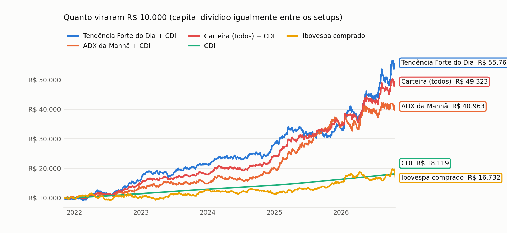
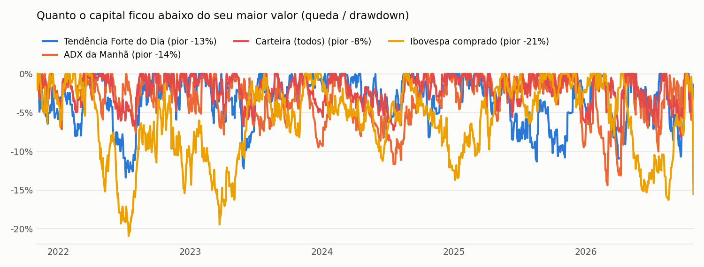
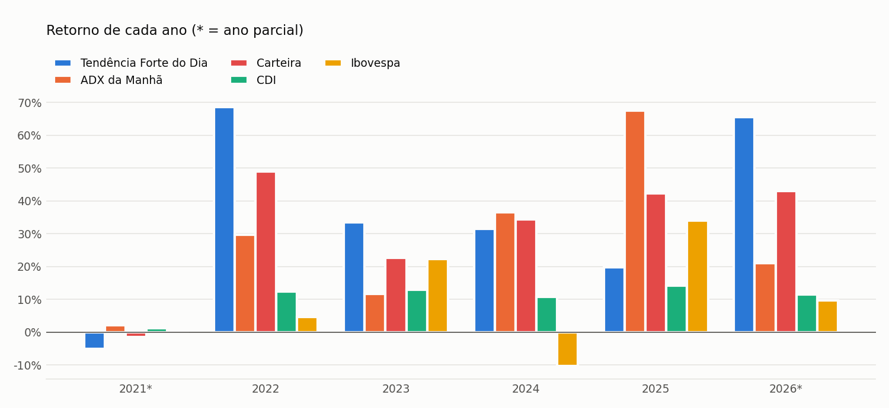

**O que acontece quando os setups aprovados são operados juntos? A carteira divide o capital igualmente entre eles e testa todas as combinações, sempre comparando com o CDI e com o Ibovespa comprado.**

*Página gerada em 26/10/2026 20:19 BRT · dados de 01/11/2021 a 26/10/2026 · [voltar para todos os setups](./)*

> [!success] Em resumo: com R$ 10.000, operando os 2 setups juntos (capital dividido igualmente, capital no CDI)
> - **R$ 49.323** (+38% ao ano · pior queda −8% · Sharpe 1,32)
> - CDI: **R$ 18.119** (+13% ao ano) · Ibovespa: **R$ 16.732** (+11% ao ano · pior queda −21%)
> - A combinação com o **melhor retorno por risco (Sharpe)** foi: **Tendência Forte do Dia + ADX da Manhã**.

> [!warning] Leia antes
> Resultado passado, em backtest, não garante resultado futuro. É um estudo educacional, **não é recomendação de investimento**. Day trade com mini índice é alavancado: dá para perder mais do que o capital da conta.

## Todas as combinações

Cada linha divide R$ 10.000 igualmente entre os setups da combinação (1 contrato para cada R$ 10.000 dentro de cada setup), com o capital aplicado no CDI. A melhor combinação é a que rende mais **por unidade de risco**, não necessariamente a que rende mais.

| Combinação | R$ 10 mil viraram | Ao ano | Pior queda | Sharpe | Pior ano | Anos acima do CDI |
|---|---|---|---|---|---|---|
| Tendência Forte do Dia + ADX da Manhã ⭐ | R$ 49.323 | +38,2% | −8,1% | 1,32 | +22,7% | 100% |
| Tendência Forte do Dia | R$ 55.763 | +41,6% | −13,4% | 1,27 | +19,8% | 100% |
| ADX da Manhã | R$ 40.963 | +33,1% | −14,4% | 0,91 | +11,7% | 75% |
| *CDI* | *R$ 18.119* | *+12,8%* | *0%* | — | — | — |
| *Ibovespa comprado* | *R$ 16.732* | *+11,0%* | *−20,9%* | *0,01* | — | — |

*Anos acima do CDI conta só os anos completos.*

## Os setups se ajudam?

Setups que ganham e perdem em **momentos diferentes** se completam: um segura a carteira enquanto o outro atravessa uma fase ruim. A correlação mede isso (1 = andam juntos, 0 = independentes, negativo = opostos).

| | Tendência Forte do Dia | ADX da Manhã |
|---|---|---|
| **Tendência Forte do Dia** | 1,00 | 0,24 |
| **ADX da Manhã** | 0,24 | 1,00 |

*Correlação do resultado mensal.*

- **Tendência Forte do Dia** e **ADX da Manhã** operaram no mesmo dia em 65% dos dias em que pelo menos um deles operou.

## Ano a ano

| Ano | Tendência Forte do Dia | ADX da Manhã | Carteira (todos) | CDI | Ibovespa | Quem ganhou |
|---|---|---|---|---|---|---|
| 2021* | −5,2% | +2,1% | −1,5% | +1,3% | −0,7% | ADX da Manhã |
| 2022 | +68,7% | +29,8% | +49,0% | +12,3% | +4,7% | Tendência Forte do Dia |
| 2023 | +33,5% | +11,7% | +22,7% | +13,0% | +22,3% | Tendência Forte do Dia |
| 2024 | +31,5% | +36,5% | +34,5% | +10,8% | −10,4% | ADX da Manhã |
| 2025 | +19,8% | +67,5% | +42,4% | +14,2% | +34,0% | ADX da Manhã |
| 2026* | +65,6% | +21,0% | +43,0% | +11,4% | +9,6% | Tendência Forte do Dia |

\* ano parcial: os dados vão de 01/11/2021 a 26/10/2026.

> [!example]- Mês a mês (clique para abrir)
> | Mês | Tendência Forte do Dia | ADX da Manhã | Carteira (todos) | CDI | Ibovespa |
> |---|---|---|---|---|---|
> | nov/2021 | −5,5% | +1,3% | −2,1% | +0,6% | −3,4% |
> | dez/2021 | +0,4% | +0,8% | +0,7% | +0,7% | +2,9% |
> | jan/2022 | +2,8% | +2,7% | +2,8% | +0,7% | +7,0% |
> | fev/2022 | −4,1% | −1,1% | −2,6% | +0,8% | +0,9% |
> | mar/2022 | +15,0% | +4,5% | +9,7% | +0,9% | +6,1% |
> | abr/2022 | +12,8% | −4,1% | +4,1% | +0,8% | −10,1% |
> | mai/2022 | −3,1% | +6,6% | +1,7% | +1,0% | +3,2% |
> | jun/2022 | −4,6% | −1,2% | −2,9% | +1,0% | −11,5% |
> | jul/2022 | −0,3% | −2,9% | −1,5% | +1,0% | +4,7% |
> | ago/2022 | +12,3% | +12,3% | +12,4% | +1,2% | +6,2% |
> | set/2022 | +8,8% | −1,7% | +3,5% | +1,1% | +0,5% |
> | out/2022 | +10,1% | +6,3% | +8,2% | +1,0% | +5,5% |
> | nov/2022 | +0,0% | −1,0% | −0,4% | +1,0% | −3,1% |
> | dez/2022 | +6,5% | +7,2% | +6,9% | +1,1% | −2,4% |
> | jan/2023 | +16,5% | −0,1% | +7,9% | +1,1% | +3,4% |
> | fev/2023 | +0,1% | +7,9% | +3,9% | +0,9% | −7,5% |
> | mar/2023 | +1,7% | −2,9% | −0,6% | +1,2% | −2,9% |
> | abr/2023 | −3,9% | +6,3% | +1,1% | +0,9% | +2,5% |
> | mai/2023 | −5,8% | +4,7% | −0,6% | +1,1% | +3,7% |
> | jun/2023 | +8,0% | −4,6% | +1,5% | +1,1% | +9,0% |
> | jul/2023 | +6,3% | +3,2% | +4,8% | +1,1% | +3,3% |
> | ago/2023 | +4,1% | +0,6% | +2,3% | +1,1% | −5,1% |
> | set/2023 | −2,5% | −1,6% | −2,0% | +1,0% | +0,7% |
> | out/2023 | +2,0% | +1,0% | +1,6% | +1,0% | −2,9% |
> | nov/2023 | +3,8% | +3,4% | +3,6% | +0,9% | +12,5% |
> | dez/2023 | +1,0% | −5,7% | −2,4% | +0,9% | +5,4% |
> | jan/2024 | +5,5% | +10,5% | +8,0% | +1,0% | −4,8% |
> | fev/2024 | +5,6% | +7,2% | +6,4% | +0,8% | +1,0% |
> | mar/2024 | −0,9% | −5,6% | −3,2% | +0,8% | −0,7% |
> | abr/2024 | +0,2% | +3,2% | +1,7% | +0,9% | −1,7% |
> | mai/2024 | +1,2% | −4,0% | −1,4% | +0,8% | −3,0% |
> | jun/2024 | −0,9% | −0,9% | −0,9% | +0,8% | +1,5% |
> | jul/2024 | −1,8% | −1,9% | −1,8% | +0,9% | +3,0% |
> | ago/2024 | +7,3% | +4,7% | +6,0% | +0,9% | +6,5% |
> | set/2024 | −0,7% | +2,2% | +0,8% | +0,8% | −3,1% |
> | out/2024 | −3,6% | +6,2% | +1,2% | +0,9% | −1,6% |
> | nov/2024 | +5,2% | +2,3% | +3,8% | +0,8% | −3,1% |
> | dez/2024 | +11,7% | +9,0% | +10,4% | +0,8% | −4,3% |
> | jan/2025 | +7,8% | +8,6% | +8,3% | +1,0% | +4,9% |
> | fev/2025 | +4,1% | +5,5% | +4,8% | +1,0% | −2,6% |
> | mar/2025 | +5,4% | +7,3% | +6,4% | +1,0% | +6,1% |
> | abr/2025 | −2,2% | +0,7% | −0,7% | +1,1% | +3,7% |
> | mai/2025 | +1,9% | +10,5% | +6,2% | +1,1% | +1,5% |
> | jun/2025 | −4,5% | +2,0% | −1,3% | +1,1% | +1,3% |
> | jul/2025 | −1,8% | +4,0% | +1,1% | +1,3% | −4,2% |
> | ago/2025 | +5,1% | +8,2% | +6,7% | +1,2% | +6,3% |
> | set/2025 | −5,2% | +3,8% | −0,8% | +1,2% | +3,4% |
> | out/2025 | −0,8% | +5,6% | +2,4% | +1,3% | +2,3% |
> | nov/2025 | +7,4% | +7,3% | +7,3% | +1,1% | +6,4% |
> | dez/2025 | +2,0% | −9,2% | −3,7% | +1,1% | +1,3% |
> | jan/2026 | +12,0% | +7,8% | +10,0% | +1,2% | +12,6% |
> | fev/2026 | +3,5% | −10,0% | −3,4% | +1,0% | +4,1% |
> | mar/2026 | −6,3% | +1,5% | −2,4% | +1,2% | −0,7% |
> | abr/2026 | +14,3% | +18,9% | +16,7% | +1,1% | −0,1% |
> | mai/2026 | +7,1% | +1,0% | +4,1% | +1,1% | −7,2% |
> | jun/2026 | −2,0% | −0,2% | −1,1% | +1,1% | −1,0% |
> | jul/2026 | +10,9% | −0,4% | +5,3% | +1,2% | +3,5% |
> | ago/2026 | +0,9% | +4,2% | +2,6% | +1,1% | −0,3% |
> | set/2026 | +6,7% | +1,0% | +3,9% | +1,1% | +5,0% |
> | out/2026 | +6,4% | −2,2% | +2,1% | +0,8% | −5,2% |

## Como a carteira é montada

- Cada setup entra com a **versão principal** da sua página.
- O capital é **dividido igualmente** entre os setups da combinação, com 1 contrato para cada R$ 10.000 dentro de cada setup, e fica aplicado no CDI. O resultado de cada dia é a média dos setups mais o CDI do dia.
- Custo de 15 pontos por operação, sem imposto. Resultado passado, em backtest.

*Leitura educacional baseada em backtest. Não é recomendação de investimento.*
