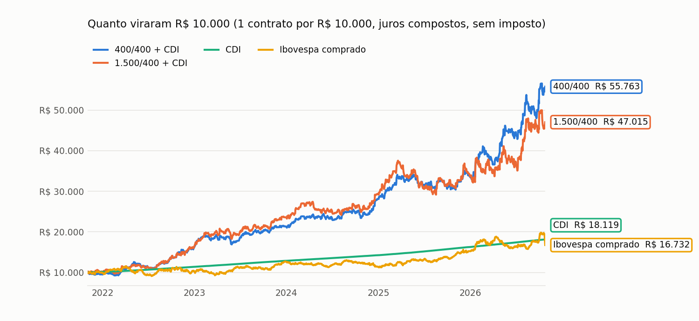
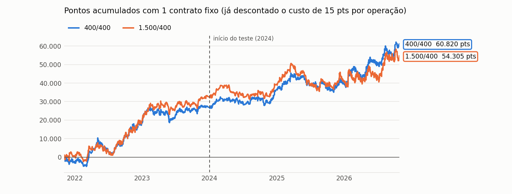
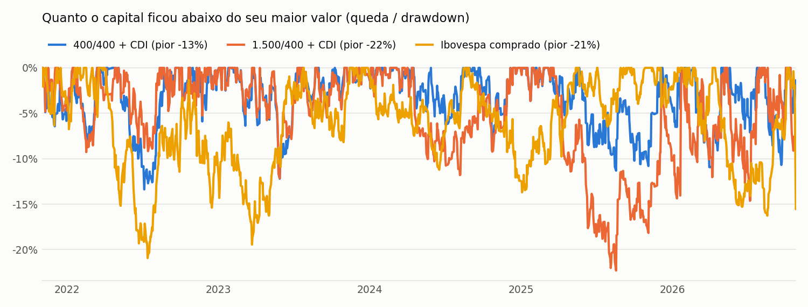
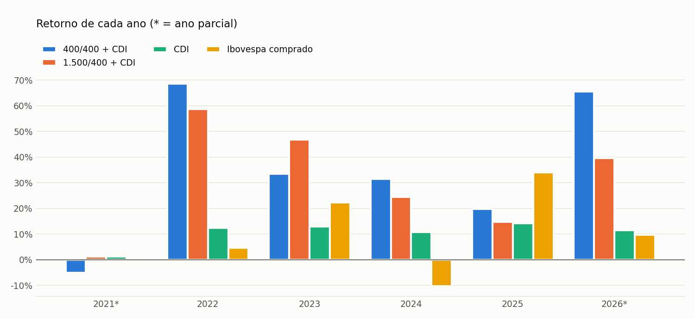

**Entra a favor do dia que já mostrou força: preço do lado certo das 3 médias, 700 pontos longe da abertura e uma vela confirmando.**

✅ aprovado · Mini índice (WIN) · gráfico de 15 minutos · sinais da 1ª vela do dia até 17h00

🎬 **Vídeo de origem:** [Arthur 777 – "encontrei uma coisa absurda nos testes"](https://youtu.be/N4CJ9Yv8To8) · testado de forma independente nos nossos dados em 25/10/2026 · página gerada em 26/10/2026 20:19 BRT · [voltar para todos os setups](./)

> [!success] Em resumo: R$ 10.000 aplicados em nov/2021 viraram
> - **R$ 55.763** na versão 400/400 com o capital no CDI (+42% ao ano · pior queda −13%)
> - **R$ 47.015** na versão 1.500/400 com o capital no CDI (+37% ao ano · pior queda −22%)
> - **R$ 18.119** só no CDI (+13% ao ano)
> - **R$ 16.732** comprado no Ibovespa (+11% ao ano · pior queda −21%)
>
> Com 1 contrato de WIN para cada R$ 10.000, sem imposto.

> [!warning] Leia antes
> Resultado passado, em backtest, não garante resultado futuro. É um estudo educacional, **não é recomendação de investimento**. Day trade com mini índice é alavancado: dá para perder mais do que o capital da conta.

## Como o setup funciona

| | 🟢 Compra | 🔴 Venda |
|---|---|---|
| **1. Tendência** | a vela **fecha acima** das médias exponenciais de 9, 50 e 200 períodos | a vela **fecha abaixo** das três médias |
| **2. Força do dia** | o fechamento está **pelo menos 700 pontos acima** da abertura do dia | o fechamento está **pelo menos 700 pontos abaixo** da abertura do dia |
| **3. Gatilho** | a vela **fecha acima da máxima** da vela anterior | a vela **fecha abaixo da mínima** da vela anterior |
| **Entrada** | compra **a mercado** na abertura da vela seguinte | vende a mercado na abertura da vela seguinte |
| **Stop** | 400 pontos abaixo da entrada | 400 pontos acima da entrada |
| **Alvo** | 400 pontos (versão principal) ou 1.500 pontos | o mesmo, para baixo |
| **Fim do dia** | se não bateu stop nem alvo, zera às 18h20 | igual |

- **Quantas operações:** sem limite por dia, mas uma de cada vez — enquanto o dia continuar forte, o setup entra de novo depois que a operação anterior termina.
- **A ordem das médias entre si não importa**, só o preço estar do mesmo lado das três.
- **A ideia:** em dia de tendência forte, cada nova vela de força tende a ter continuação.

### As versões testadas

| | 400/400 (principal) | 1.500/400 |
|---|---|---|
| Regra | alvo 400 · stop 400 | alvo 1.500 · stop 400 |
| Acerto | 55% | 36% |
| Payoff | 0,94 | 2,02 |
| Treino → teste (pts por operação) | +24,0 → +21,2 | +52,7 → +22,6 |
| Retorno ao ano (+ CDI) | +41,6% | +36,8% |
| Pior queda (+ CDI) | −13,4% | −22,3% |

## Estatísticas da operação (1 contrato, em pontos)

Cada operação já desconta **15 pontos de custo** (corretagem, emolumentos e escorregão). R$ = pontos × R$ 0,20 por contrato. **Treino** = nov/2021 a dez/2023 · **Teste** = 2024 até hoje.

### Versão 400/400

| | Treino | Teste | Total |
|---|---|---|---|
| Operações | 1.131 | 1.591 | 2.722 |
| Operações por mês | 41,9 | 46,8 | 44,6 |
| Taxa de acerto | 54,8% | 54,6% | 54,7% |
| Bateram o alvo / o stop / zeraram no fim do dia | 48% / 39% / 13% | 49% / 40% / 11% | 49% / 40% / 12% |
| Stop típico | 400 pts | 400 pts | 400 pts |
| Ganho médio · perda média | +357 · −380 pts | +360 · −386 pts | +359 · −383 pts |
| Payoff (ganho médio ÷ perda média) | 0,94 | 0,93 | 0,94 |
| Fator de lucro (total ganho ÷ total perdido) | 1,14 | 1,12 | 1,13 |
| Resultado médio por operação | +24,0 pts (+39,0 sem custo) | +21,2 pts (+36,2 sem custo) | +22,3 pts (+37,3 sem custo) |
| **Lucro líquido** | **+27.155 pts · R$ 5.431** | **+33.665 pts · R$ 6.733** | **+60.820 pts · R$ 12.164** |
| Pior queda (drawdown) | −8.935 pts · −R$ 1.787 | −10.310 pts · −R$ 2.062 | −10.310 pts · −R$ 2.062 |
| Maior sequência de perdas | 8 seguidas | 10 seguidas | 10 seguidas |
| Compras: acerto · lucro | 56% · +14.665 pts | 55% · +19.400 pts | 55% · +34.065 pts |
| Vendas: acerto · lucro | 54% · +12.490 pts | 54% · +14.265 pts | 54% · +26.755 pts |

### Versão 1.500/400

| | Treino | Teste | Total |
|---|---|---|---|
| Operações | 622 | 951 | 1.573 |
| Operações por mês | 23,0 | 28,0 | 25,8 |
| Taxa de acerto | 39,5% | 33,8% | 36,0% |
| Bateram o alvo / o stop / zeraram no fim do dia | 8% / 53% / 39% | 11% / 59% / 29% | 10% / 57% / 33% |
| Stop típico | 400 pts | 400 pts | 400 pts |
| Ganho médio · perda média | +716 · −381 pts | +827 · −387 pts | +779 · −385 pts |
| Payoff (ganho médio ÷ perda média) | 1,88 | 2,14 | 2,02 |
| Fator de lucro (total ganho ÷ total perdido) | 1,23 | 1,09 | 1,14 |
| Resultado médio por operação | +52,7 pts (+67,7 sem custo) | +22,6 pts (+37,6 sem custo) | +34,5 pts (+49,5 sem custo) |
| **Lucro líquido** | **+32.775 pts · R$ 6.555** | **+21.530 pts · R$ 4.306** | **+54.305 pts · R$ 10.861** |
| Pior queda (drawdown) | −7.230 pts · −R$ 1.446 | −15.055 pts · −R$ 3.011 | −15.055 pts · −R$ 3.011 |
| Maior sequência de perdas | 14 seguidas | 15 seguidas | 15 seguidas |
| Compras: acerto · lucro | 41% · +16.930 pts | 34% · +16.765 pts | 37% · +33.695 pts |
| Vendas: acerto · lucro | 38% · +15.845 pts | 34% · +4.765 pts | 35% · +20.610 pts |

> [!info]- O que significa cada número (clique para abrir)
> - **Taxa de acerto:** de cada 100 operações, quantas deram lucro.
> - **Payoff:** o ganho médio de uma operação boa dividido pela perda média de uma ruim. Payoff 2 = ganha o dobro do que perde.
> - **Fator de lucro:** tudo o que foi ganho dividido por tudo o que foi perdido. Acima de 1 = deu lucro.
> - **Risco/retorno:** o tamanho do alvo comparado com o do stop.
> - **Drawdown (pior queda):** a maior distância entre o ponto mais alto do lucro acumulado e o fundo que veio depois — o pior momento que alguém teria passado seguindo o setup.
> - **Sharpe:** quanto o investimento rendeu acima do CDI para cada unidade de oscilação. Acima de 1 é muito bom.
> - **Treino e teste:** os parâmetros vêm do vídeo; 2024 em diante funciona como prova — se o setup só funcionasse no passado, o teste ia mostrar.

## Comparação com o CDI e com o Ibovespa comprado

A conta usa **R$ 10.000 de capital para cada contrato** (o número de contratos cresce junto com o capital). Na versão **+ CDI** o capital fica aplicado no CDI / Tesouro Selic (aceito como garantia) e o resultado do setup soma por cima — é a comparação justa. Na **pura**, o capital fica parado. O Ibovespa já inclui dividendos. Sem imposto.

| | 400/400 + CDI | 1.500/400 + CDI | 400/400 pura | CDI | Ibovespa |
|---|---|---|---|---|---|
| **R$ 10.000 viraram** | **R$ 55.763** | **R$ 47.015** | **R$ 30.792** | **R$ 18.119** | **R$ 16.732** |
| Retorno ao ano | +41,6% | +36,8% | +25,6% | +12,8% | +11,0% |
| Pior queda | −13,4% | −22,3% | −18,3% | +0,0% | −20,9% |
| Oscilação ao ano | 19,3% | 23,3% | 19,3% | 0,1% | 18,6% |
| Sharpe (acima do CDI) | 1,27 | 0,95 | 0,65 | — | 0,01 |
| Meses acima do CDI | 58% | 63% | 50% | — | 55% |
| Meses acima do Ibovespa | 57% | 62% | 50% | 45% | — |
| Pior mês · melhor mês | −6,3% · +16,5% | −8,6% · +15,2% | −7,4% · +15,2% | +0,6% · +1,3% | −11,5% · +12,6% |

### Ano a ano

| Ano | 400/400 + CDI | 1.500/400 + CDI | CDI | Ibovespa | Quem ganhou |
|---|---|---|---|---|---|
| 2021* | −5,2% | +1,3% | +1,3% | −0,7% | 1.500/400 + CDI |
| 2022 | +68,7% | +58,7% | +12,3% | +4,7% | 400/400 + CDI |
| 2023 | +33,5% | +46,9% | +13,0% | +22,3% | 1.500/400 + CDI |
| 2024 | +31,5% | +24,4% | +10,8% | −10,4% | 400/400 + CDI |
| 2025 | +19,8% | +14,7% | +14,2% | +34,0% | Ibovespa |
| 2026* | +65,6% | +39,6% | +11,4% | +9,6% | 400/400 + CDI |

\* ano parcial: os dados vão de 01/11/2021 a 26/10/2026.

> [!example]- Mês a mês (clique para abrir)
> | Mês | 400/400 + CDI | 1.500/400 + CDI | CDI | Ibovespa |
> |---|---|---|---|---|
> | nov/2021 | −5,5% | −1,8% | +0,6% | −3,4% |
> | dez/2021 | +0,4% | +3,2% | +0,7% | +2,9% |
> | jan/2022 | +2,8% | +2,7% | +0,7% | +7,0% |
> | fev/2022 | −4,1% | −5,3% | +0,8% | +0,9% |
> | mar/2022 | +15,0% | +13,1% | +0,9% | +6,1% |
> | abr/2022 | +12,8% | +6,7% | +0,8% | −10,1% |
> | mai/2022 | −3,1% | −3,6% | +1,0% | +3,2% |
> | jun/2022 | −4,6% | −2,4% | +1,0% | −11,5% |
> | jul/2022 | −0,3% | −1,0% | +1,0% | +4,7% |
> | ago/2022 | +12,3% | +15,2% | +1,2% | +6,2% |
> | set/2022 | +8,8% | +6,6% | +1,1% | +0,5% |
> | out/2022 | +10,1% | +7,0% | +1,0% | +5,5% |
> | nov/2022 | +0,0% | +4,4% | +1,0% | −3,1% |
> | dez/2022 | +6,5% | +5,8% | +1,1% | −2,4% |
> | jan/2023 | +16,5% | +14,1% | +1,1% | +3,4% |
> | fev/2023 | +0,1% | +5,7% | +0,9% | −7,5% |
> | mar/2023 | +1,7% | +2,9% | +1,2% | −2,9% |
> | abr/2023 | −3,9% | −1,8% | +0,9% | +2,5% |
> | mai/2023 | −5,8% | −4,7% | +1,1% | +3,7% |
> | jun/2023 | +8,0% | +6,9% | +1,1% | +9,0% |
> | jul/2023 | +6,3% | +6,4% | +1,1% | +3,3% |
> | ago/2023 | +4,1% | +1,8% | +1,1% | −5,1% |
> | set/2023 | −2,5% | −2,4% | +1,0% | +0,7% |
> | out/2023 | +2,0% | +1,0% | +1,0% | −2,9% |
> | nov/2023 | +3,8% | +8,0% | +0,9% | +12,5% |
> | dez/2023 | +1,0% | +2,6% | +0,9% | +5,4% |
> | jan/2024 | +5,5% | +3,1% | +1,0% | −4,8% |
> | fev/2024 | +5,6% | +10,9% | +0,8% | +1,0% |
> | mar/2024 | −0,9% | +0,2% | +0,8% | −0,7% |
> | abr/2024 | +0,2% | −5,4% | +0,9% | −1,7% |
> | mai/2024 | +1,2% | −1,4% | +0,8% | −3,0% |
> | jun/2024 | −0,9% | +1,2% | +0,8% | +1,5% |
> | jul/2024 | −1,8% | −2,8% | +0,9% | +3,0% |
> | ago/2024 | +7,3% | +2,5% | +0,9% | +6,5% |
> | set/2024 | −0,7% | +3,3% | +0,8% | −3,1% |
> | out/2024 | −3,6% | −3,0% | +0,9% | −1,6% |
> | nov/2024 | +5,2% | +6,3% | +0,8% | −3,1% |
> | dez/2024 | +11,7% | +8,5% | +0,8% | −4,3% |
> | jan/2025 | +7,8% | +12,0% | +1,0% | +4,9% |
> | fev/2025 | +4,1% | +6,2% | +1,0% | −2,6% |
> | mar/2025 | +5,4% | +3,7% | +1,0% | +6,1% |
> | abr/2025 | −2,2% | −8,2% | +1,1% | +3,7% |
> | mai/2025 | +1,9% | +2,2% | +1,1% | +1,5% |
> | jun/2025 | −4,5% | −8,6% | +1,1% | +1,3% |
> | jul/2025 | −1,8% | −2,3% | +1,3% | −4,2% |
> | ago/2025 | +5,1% | +9,4% | +1,2% | +6,3% |
> | set/2025 | −5,2% | −5,3% | +1,2% | +3,4% |
> | out/2025 | −0,8% | −1,3% | +1,3% | +2,3% |
> | nov/2025 | +7,4% | +6,7% | +1,1% | +6,4% |
> | dez/2025 | +2,0% | +1,7% | +1,1% | +1,3% |
> | jan/2026 | +12,0% | +10,1% | +1,2% | +12,6% |
> | fev/2026 | +3,5% | −6,8% | +1,0% | +4,1% |
> | mar/2026 | −6,3% | +2,1% | +1,2% | −0,7% |
> | abr/2026 | +14,3% | +7,6% | +1,1% | −0,1% |
> | mai/2026 | +7,1% | −1,7% | +1,1% | −7,2% |
> | jun/2026 | −2,0% | −0,1% | +1,1% | −1,0% |
> | jul/2026 | +10,9% | +13,2% | +1,2% | +3,5% |
> | ago/2026 | +0,9% | +5,6% | +1,1% | −0,3% |
> | set/2026 | +6,7% | +2,9% | +1,1% | +5,0% |
> | out/2026 | +6,4% | +2,3% | +0,8% | −5,2% |

### E se o capital por contrato for outro?

| Capital por contrato | 400/400 + CDI | 1.500/400 + CDI |
|---|---|---|
| R$ 5.000 | +72% ao ano · pior queda −28% | +58% ao ano · pior queda −44% |
| R$ 10.000 | +42% ao ano · pior queda −13% | +37% ao ano · pior queda −22% |
| R$ 20.000 | +27% ao ano · pior queda −6% | +25% ao ano · pior queda −9% |
| R$ 40.000 | +20% ao ano · pior queda −2% | +19% ao ano · pior queda −3% |

*Referência: CDI +13% ao ano · Ibovespa +11% ao ano, pior queda −21%.*

## O que os testes mostraram

*Testes de robustez rodados em 25/10/2026.*

| Pergunta | Resposta |
|---|---|
| **Bate com o vídeo?** | Sim. No 1.500/400 o vídeo mostra 32% de acerto, payoff 2,52 e fator de lucro 1,19; nos nossos dados deu 36%, 2,10 e 1,21 (sem custo). |
| **Ganha do acaso?** | Sim. Entradas em horários quaisquer, com o mesmo alvo e stop, perdem de 9 a 19 pts por operação; o setup ganha cerca de 20 pts por operação no teste (p < 0,05). |
| **É sorte de parâmetro?** | Não. Distância 500/700/900 pts × stop 300/400/500 pts: as 9 combinações deram lucro no treino **e** no teste, nas duas versões. |
| **Cada condição importa?** | Sim. Tirar as médias, a distância ou o gatilho piora; cada condição sozinha não funciona. |
| **Funciona com o mercado de outro tamanho?** | Sim. Com distância, stop e alvo proporcionais ao ATR diário em vez de pontos fixos, o resultado foi igual ou melhor. |
| **Aguenta custo maior?** | Até uns 30 pts por operação; no teste o lucro só zera com ~36 pts. |

## Riscos e cuidados

- **Fases ruins:** a pior queda da versão 400/400 foi de −R$ 2.062 por contrato (começou em mar/2025, recuperada em fev/2026); 10 perdas seguidas aconteceram no período.
- **Mês a mês é quase cara ou coroa:** a versão 400/400 + CDI ficou abaixo do CDI em 42% dos meses. O resultado aparece no ano.
- **Pontos fixos:** 700 e 400 pontos eram uma fatia maior do índice em 2021 (~105 mil) do que hoje (~210 mil). A versão com ATR mostrou que a ideia continua valendo.
- **Poucos anos de dados** (desde out/2021) e **sem imposto** (day trade paga 20% sobre o lucro).

## Como o teste foi feito

- **Dados:** WIN$N em velas de 1 minuto do MetaTrader 5, de 25/10/2021 a 26/10/2026, com os saltos das rolagens ajustados para os indicadores; resultados em **pontos reais** do contrato de cada época.
- **Execução realista:** cada operação acompanhada minuto a minuto; stop e alvo no mesmo minuto contam como **stop**; se o preço abriu além do stop, a saída foi no preço da abertura.
- **Custo:** 15 pontos por operação. **CDI:** série diária do Banco Central. **Ibovespa:** fechamento diário, comprado o período todo.
- **Os parâmetros vieram prontos do vídeo**; o período de 2024 em diante serviu como prova.

*Leitura educacional baseada em backtest. Não é recomendação de investimento.*
